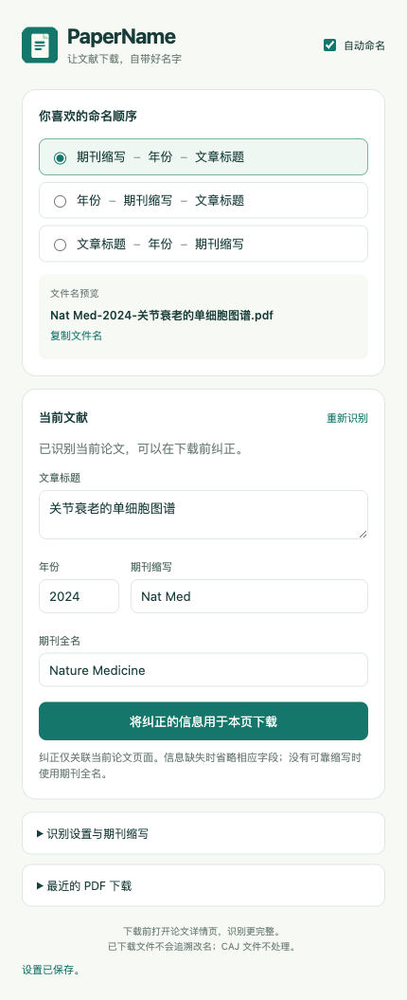

# PaperName · 文献 PDF 自动命名

在 Microsoft Edge 中下载论文 PDF 时，自动用 **期刊缩写、年份、文章标题**命名。支持中文和英文标题、三种顺序、离线期刊缩写表及本页手动纠正。

**Automatically name scholarly PDF downloads by journal abbreviation, publication year and article title.** Built for Microsoft Edge with Manifest V3; Chrome compatibility has not been independently verified.

## 下载与安装

从 [最新版本](https://github.com/Charterhale/PaperName/releases/latest) 下载 `PaperName-Edge-v1.0.0.zip`，解压后：

1. 在 Edge 地址栏输入 `edge://extensions`。
2. 打开“开发人员模式”，选择“加载解压缩的扩展”。
3. 选择解压目录中的 **extension** 文件夹（其中直接包含 `manifest.json`）。
4. 固定到工具栏，刷新已经打开的论文页面，再开始下载。

也可直接下载或克隆本仓库，加载仓库根目录下的 `extension/`。使用插件不需要安装 Node.js、Python 或额外账户。尚未发布到浏览器扩展商店。

## 三种顺序

| 顺序 | 示例 |
| --- | --- |
| 期刊缩写-年份-文章标题（默认） | `Nat Med-2024-Joint aging.pdf` |
| 年份-期刊缩写-文章标题 | `2024-Nat Med-Joint aging.pdf` |
| 文章标题-年份-期刊缩写 | `Joint aging-2024-Nat Med.pdf` |

点击插件图标即可切换顺序、预览名称、纠正文献信息和保存自定义期刊缩写。



## 识别范围

通用期刊页面支持 citation、Dublin Core、PRISM 标签和 JSON-LD。另提供 PubMed、PMC、谷歌学术单条搜索结果、Web of Science 详情页、知网和万方的识别规则。

页面识别规则不等于这些网站的所有页面、机构代理和登录流程都已实测，也不能保证覆盖“绝大部分网站”的具体百分比。信息缺失或下载来源无法可靠关联时：

- 缺少可靠缩写：使用期刊全名。
- 缺少年份或期刊：省略缺失字段。
- 缺少可靠标题：保留原名。

插件只处理你发起的 PDF 下载，不自动获取论文、不绕过网站访问权限、不改 CAJ，也不会给已下载文件追溯改名。内置 PDF 阅读器、Blob 和部分中转下载可能无法关联来源；可回到论文详情页下载或手动纠正。

## 元数据、权限与隐私

- 页面元数据与下载来源的关联在本机处理；不会根据活动标签页猜测任意下载属于哪篇论文。
- 随包提供 NLM 离线期刊表：2026-10-10 构建，42,086 条有可用缩写的记录。同名但指向不同缩写的键不强行选择。
- 可选在线补全只向 Crossref / NCBI 发送 DOI / PMID，不上传 PDF、页面正文、下载链接或网站登录 Cookie。可在设置中关闭。
- 设置、最近 12 条处理记录和最多 200 条在线元数据缓存存储在本机，可清空。
- 网站访问权限用于在各期刊、数据库和机构代理网站读取文献元数据；下载权限用于建议文件名和检查下载状态。

详细权限和使用边界见 [使用说明](使用说明.md)。

## 验证

初始版本通过 19 组核心/后台测试和 19 组 Edge 集成验证。Edge 原生下载验证使用本地测试页面及生成的 PDF；数据库选择器使用模拟页面，并非所有网站实际账户流程的验证。

见 [验证说明](验证说明.md) 和 [验证结果](验证结果.json)。

### 运行核心与后台测试

安装 Node.js 20 或以上后，不需要安装依赖即可运行：

```sh
npm test
```

### 运行 Edge 集成测试

已安装 Microsoft Edge 的电脑上：

```sh
npm install
npm run test:browser
```

默认使用 Playwright 的 `msedge` 通道。可通过 `PAPERNAME_BROWSER_PATH` 指定浏览器可执行文件，或通过 `PAPERNAME_BROWSER_CHANNEL` 指定通道。测试使用独立临时浏览器配置和下载目录，运行产物保存到忽略的 `.artifacts/`，不会使用日常浏览器配置。

### 构建安装包

```sh
python3 scripts/package.py
```

更新 NLM 数据时，从 [官方原始文件](https://ftp.ncbi.nih.gov/pubmed/J_Entrez.txt) 下载 `J_Entrez.txt` 到 `extension/data/`，再运行 `python3 scripts/build_data.py`。生成索引会记录构建日期，原始文本不纳入仓库或安装包。

## 源码结构

```text
extension/
  manifest.json       浏览器扩展入口与权限
  background.js       下载处理、在线补全与存储
  content.js          页面信息和点击事件
  lib/core.js         安全文件名与来源关联
  lib/extract.js      标准元数据及网站识别规则
  data/journals.json  NLM 离线期刊缩写索引
  popup.*             中文设置与预览
tests/                核心、后台和浏览器验证
scripts/              数据构建与打包
```

## 反馈与贡献

欢迎通过 [Issues](https://github.com/Charterhale/PaperName/issues) 提交无法识别的公开论文页面、预期名称和实际名称；适配新网站的规则请同时提供最小模拟页面和测试。贡献流程见 [CONTRIBUTING.md](CONTRIBUTING.md)。

## 许可与数据来源

自编源码采用 [MIT License](LICENSE)。期刊元数据来源及数据许可边界见 [DATA_SOURCES.md](DATA_SOURCES.md)，MIT 声明不替代第三方数据的原有条款。
